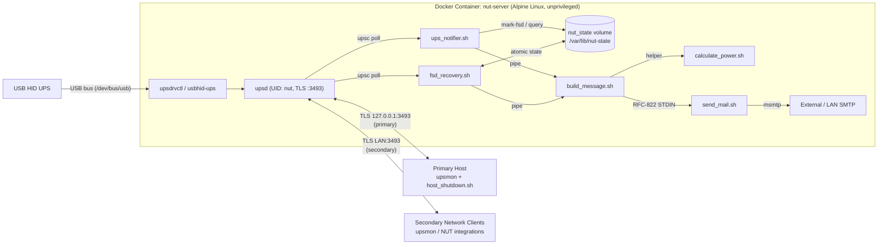
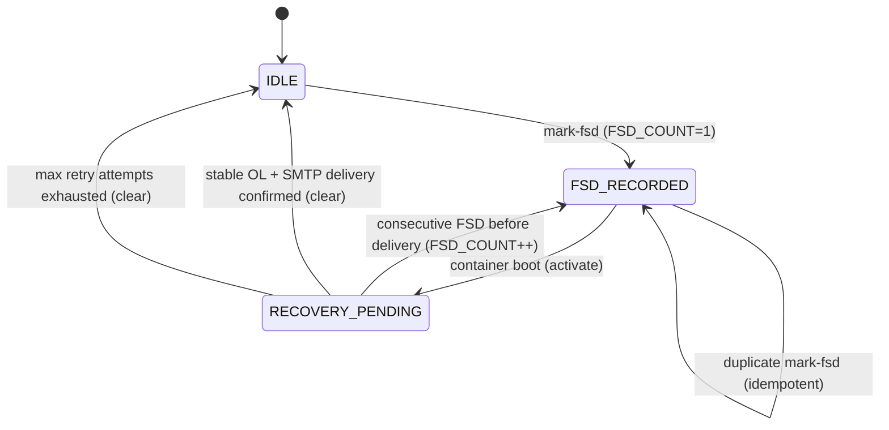
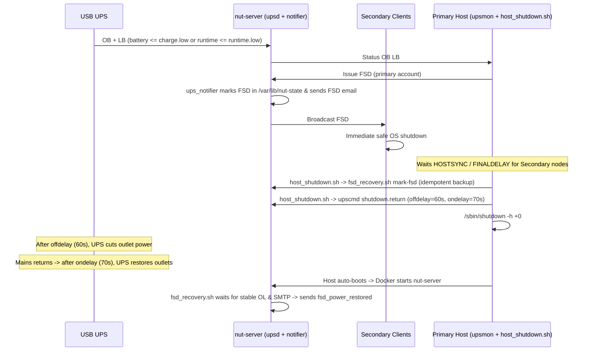

# Architecture Guide — `ups_sharing`

This document describes the internal architecture, security boundaries, module organization, state machines, and shutdown/recovery flows of **`ups_sharing`**.

For installation instructions, feature overview, and day-to-day usage, see [README.md](README.md).

---

## 1. System Overview & Topology

`ups_sharing` splits responsibilities across three clear trust boundaries:

1. **NUT Server Container (`nut-server`)**: An unprivileged Alpine Linux container (~25 MB disk, ~7 MB RAM) that owns USB UPS communication (`usbhid-ups` via `upsdrvctl`), serves encrypted network telemetry (`upsd` on TCP `3493` over NSS TLS), runs the real-time event monitor (`ups_notifier.sh`), and manages post-shutdown recovery alerts (`fsd_recovery.sh`). It **never** executes host shutdown commands.
2. **Primary Bare-Metal Host (`primary`)**: The Docker host itself runs `nut-client` (`upsmon`) connected over loopback (`127.0.0.1:3493`) with the privileged `API_USER` (`primary`) account. It coordinates network-wide Forced Shutdown (`FSD`) when Low Battery (`LB`) is reached and runs `utils/host_shutdown.sh` to schedule delayed UPS outlet power-off before halting the OS.
3. **Secondary Network Clients (`secondary`)**: Remote servers, workstations, NAS appliances, hypervisors, or monitoring dashboards connect to `<DOCKER_HOST_IP>:3493` over TLS using the read-only `SECONDARY_USER` (`secondary`) account. When `FSD` is broadcast, Secondary nodes shut down safely before the Primary host halts.



---

## 2. Repository & Module Structure

Every script follows single-responsibility decomposition with clean interfaces (shared libraries, CLI subcommands, environment variables, or UNIX `STDIN`/`STDOUT` pipes):

```text
ups_sharing/
├── docker-compose.yml              # Unprivileged service, USB cgroup rule (189:*), Docker Secrets, volumes
├── README.md                       # User-facing overview, features, quick start, and client setup
├── ARCHITECTURE.md                 # This document: internal design, security model, and state machines
├── configs/                        # Mounted read-only into container at /etc/nut-config:ro
│   ├── .env.example                # Non-sensitive runtime configuration template
│   ├── nut.conf                    # NUT operating mode (MODE=netserver)
│   ├── upsd.conf                   # Network listener, timeouts, and NSS TLS certificate paths
│   ├── ups.conf                    # Generated UPS driver config & LB overrides (gitignored)
│   └── secrets/                    # RAM-mounted Docker Secrets (tracked via .gitkeep, files gitignored)
│       ├── nut_password.txt        # Primary account password (chmod 400)
│       ├── nut_secondary_password.txt # Secondary account password (chmod 400)
│       └── smtp_password.txt       # SMTP password (chmod 400)
├── image/                          # Container build context (POSIX /bin/sh runtime)
│   ├── VERSION                     # Semantic version string
│   ├── Dockerfile                  # Minimal Alpine Linux image (nut, libusb, nss-tools, msmtp)
│   ├── entrypoint.sh               # Concise container lifecycle orchestrator & signal handler
│   ├── alerts/                     # Key-value localization dictionaries (en.lang, it.lang)
│   ├── smtp_configs/               # SMTP provider templates (gmail.conf, outlook.conf, custom.conf.example)
│   └── scripts/                    # Modular notification & bootstrap subsystem
│       ├── lib/
│       │   ├── lock.sh             # Reusable POSIX atomic directory mutex with stale-PID recovery
│       │   └── bootstrap.sh        # Config validation, secrets ingestion, msmtp/upsd.users/TLS setup
│       ├── ups_telemetry.sh        # UPS discovery, upsc snapshot parser, voltage refresh, ups.conf overrides
│       ├── ups_notifier.sh         # Event polling daemon & alert state machine
│       ├── fsd_recovery.sh         # Persistent post-FSD recovery state & retry worker
│       ├── build_message.sh        # Localized RFC-822 alert formatter & NUT status translator
│       ├── calculate_power.sh      # Active Wattage calculator (direct or load% * nominal)
│       └── send_mail.sh            # Serialized STDIN mailer (msmtp + dry-run simulation mode)
├── utils/                          # Host administrator utilities (Bash / POSIX sh)
│   ├── setup.sh                    # Interactive TUI setup wizard orchestrator
│   ├── host_shutdown.sh            # Primary SHUTDOWNCMD: marks FSD, schedules UPS power-off, halts host
│   ├── test_email.sh               # End-to-end notification pipeline verifier
│   └── setup/                      # Single-responsibility setup wizard modules
│       ├── ui.sh                   # ANSI TUI widgets, arrow-key menus, masked secret prompts
│       ├── hardware.sh             # USB HID UPS auto-discovery & Low Battery threshold prompts
│       ├── localization.sh         # Alert language discovery & friendly label prompt
│       ├── nut_client.sh           # Primary & Secondary NUT account credential prompts
│       ├── smtp.sh                 # SMTP template discovery & credential prompts
│       ├── secrets.sh              # DAC root:root 400 secret writer
│       └── env_generator.sh        # Generator for configs/.env, configs/ups.conf, and base configs
└── tests/                          # Automated unit & integration test suite
    ├── run_tests.sh                # Test runner & assertion framework
    ├── test_lock.sh                # Atomic POSIX lock & stale-PID recovery tests
    ├── test_bootstrap.sh           # Container bootstrap, secrets, msmtprc & upsd.users tests
    ├── test_ups_telemetry.sh       # Snapshot parsing, decimal safety & stale-voltage refresh tests
    ├── test_calculate_power.sh     # Power calculation unit tests
    ├── test_build_message.sh       # Localization, formatting & FSD recovery message tests
    ├── test_fsd_recovery.sh        # Recovery lifecycle, retry backoff & anti-overlap tests
    ├── test_send_mail.sh           # Mail parsing, locking & simulation mode tests
    └── test_setup_modules.sh       # Setup wizard generators, helpers & host_shutdown dry-run tests
```

---

## 3. Security Model & Privilege Separation

`ups_sharing` enforces the **Principle of Least Privilege (PoLP)** at every layer:

### 3.1 Secrets Management (Zero Plaintext Credentials in Env or Git)
- All sensitive passwords (`nut_password.txt`, `nut_secondary_password.txt`, `smtp_password.txt`) are stored under `configs/secrets/` with strict Linux DAC permissions (`root:root`, `chmod 400`).
- Secrets are excluded from Git via `.gitignore` (only `.gitkeep` is tracked) and are **never** placed in `configs/.env` or Docker environment variables. Running `docker inspect` reveals zero passwords.
- Docker mounts secrets read-only into volatile memory (`/run/secrets/`), where `image/scripts/lib/bootstrap.sh` reads them at startup to generate in-container `/etc/nut/upsd.users` (`chmod 640 root:nut`) and `/etc/msmtprc` (`chmod 600`).

### 3.2 Unprivileged Container & Linux Kernel USB Isolation
- The container runs with **`privileged: false`** (default unprivileged Docker profile), stripping dangerous capabilities including `CAP_SYS_RAWIO`, `CAP_NET_ADMIN`, and `CAP_NET_RAW`.
- Dynamic USB access relies strictly on:
  - `device_cgroup_rules: - 'c 189:* rmw'` (char device major `189` = Linux USB devices)
  - Volume bind `/dev/bus/usb:/dev/bus/usb`
- **Dynamic re-enumeration**: When a UPS is replugged or the host reboots, USB device numbers increment dynamically. Major-189 cgroup rules allow `libusb` (`port = auto`) to rediscover and claim the UPS without static device pinning or custom host `udev` rules.
- **Single-bus / shared USB hub protection**: On single-board computers or servers where a USB hub shares a single controller with a USB-Ethernet adapter, detaching a kernel network driver via `USBDEVFS_DISCONNECT` requires `CAP_SYS_RAWIO`. Because the container lacks this capability, the Linux kernel natively rejects any attempt to tamper with host network interfaces with `-EPERM`.

### 3.3 Runtime Privilege Drop & Transport Security
- **Startup phase**: `entrypoint.sh` starts as `root` briefly to read `/run/secrets`, initialize NSS TLS certificates, apply `root:nut` permissions, and start `upsdrvctl`.
- **Steady state**: `upsd` (the only daemon exposed on TCP port `3493`) drops privileges to the unprivileged `nut` system account.
- **TLS & Role Separation**:
  - `bootstrap_init_tls_nss` auto-generates an NSS certificate database in `/etc/nut/certs` (`certutil`) so client connections over port `3493` are TLS-encrypted.
  - `upsd.users` separates the **Primary** account (`actions = SET`, `instcmds = ALL`, `upsmon primary`) from the **Secondary** account (`upsmon secondary` read-only monitoring).

---

## 4. Container Bootstrap Lifecycle (`entrypoint.sh` & `lib/bootstrap.sh`)

Container startup executes as a clean, deterministic pipeline in `image/entrypoint.sh`:

1. **`bootstrap_init_runtime_dirs`**: Removes stale `/var/run/nut/*.pid` files and prepares `/var/run/nut` and `/var/lib/nut-state`.
2. **`bootstrap_load_nut_configs`**: Validates `/etc/nut-config`, copies `ups.conf` (mandatory), copies or synthesizes defaults for `nut.conf` (`MODE=netserver`) and `upsd.conf` (port `3493` + NSS TLS), and verifies at least one `[ups]` section exists.
3. **`bootstrap_load_secrets`**: Reads `nut_password` (mandatory), `nut_secondary_password` (optional), and `smtp_password` (optional) from `/run/secrets/`.
4. **`bootstrap_validate_assets`**: Validates `/alerts/${ALERT_LANG}.lang` (falling back to `en.lang`) and verifies all internal scripts are executable.
5. **`apply_ups_conf_overrides`**: Synchronizes optional `.env` overrides (`BATTERY_CHARGE_LOW`, `BATTERY_RUNTIME_LOW`, `UPS_OFFDELAY`, `UPS_ONDELAY`) into `/etc/nut/ups.conf` and guarantees `ignorelb` is enabled when custom LB thresholds are specified.
6. **`bootstrap_configure_smtp`**: Renders `/etc/msmtprc` (`chmod 600`) for TLS/STARTTLS/authenticated or unauthenticated relays and writes `/etc/notification_email`.
7. **`bootstrap_generate_upsd_users`**: Copies a custom mounted `upsd.users` if present, or generates role-separated `primary` and `secondary` accounts.
8. **`bootstrap_init_tls_nss` & `bootstrap_harden_permissions`**: Initializes NSS certificates if absent and locks down `/etc/nut` (`root:nut`, `750`/`640`).
9. **Daemon Launch & Signal Supervision**: Starts `upsdrvctl`, resolves `UPS_NAME`, launches `ups_notifier.sh` and `fsd_recovery.sh daemon` in the background, traps `SIGTERM`/`SIGINT` (`stop_nut`), and runs `upsd -F`.

---

## 5. Notification Pipeline & Concurrency

Alerts flow through a pure Unix pipe architecture:

```text
ups_notifier.sh / fsd_recovery.sh
        │  (exports telemetry snapshot env vars)
        ▼
build_message.sh <event>
   ├── loads /alerts/en.lang (baseline) + /alerts/<ALERT_LANG>.lang (overlay)
   ├── translates NUT status flags (OL, OB, CHRG, DISCHRG, LB, FSD, OVER, ...)
   └── invokes calculate_power.sh (direct ups.realpower or load% * nominal)
        │  (RFC-822: "Subject: ...\n\n<body>" on STDOUT)
        ▼
send_mail.sh <recipient>
   ├── acquires POSIX directory mutex via lib/lock.sh
   ├── dry-run simulation if /etc/msmtprc or recipient is absent
   └── transmits UTF-8 plain-text email via msmtp
```

### Shared Atomic Locking (`image/scripts/lib/lock.sh`)
Both `fsd_recovery.sh` (protecting state file read-modify-write) and `send_mail.sh` (serializing concurrent `msmtp` invocations) reuse `lib/lock.sh`. Because Alpine `/bin/sh` has no built-in mutex primitive, locking uses atomic `mkdir` paired with a `pid` file:
- If the holder PID no longer exists (`! kill -0 "$pid"`), the stale lock is immediately reclaimed.
- A configurable timeout (default `30s`) prevents permanent deadlock across abnormal container exits.

---

## 6. Event State Machines

### 6.1 Real-Time Monitor (`image/scripts/ups_notifier.sh`)
Polls `upsc` every `NOTIFIER_POLL_INTERVAL` seconds (default `3s`) and feeds each snapshot through five decoupled handlers:

1. **Blackout (`OL -> OB`)**:
   - Records `BLACKOUT_START` epoch and resets per-outage flags.
   - **Stale Voltage Refresh**: Many USB HID drivers cache `input.voltage` until the next full HID poll cycle, temporarily reporting mains voltage (`>50 V`) immediately after switching to `OB` (or `0 V` immediately after returning to `OL`). `refresh_telemetry_on_transition` detects stale readings and triggers an on-demand HID full update (`upsrw` no-op write) so the alert reflects accurate live voltage.
   - **Charging-Deficit Protection**: If a new blackout starts while the battery is already below a threshold (e.g. `32%` right after a prior outage), thresholds already crossed (`<=70%`, `<=50%`, `<=35%`) are pre-marked as sent so only the `blackout` alert is dispatched (avoiding a 4-email burst).
2. **Power Restored (`OB -> OL`)**:
   - Queries `fsd_recovery.sh is-recovery-active`. If the post-FSD recovery daemon is actively handling recovery delivery, `ups_notifier.sh` delegates to it to guarantee **zero duplicate emails**.
   - Otherwise computes outage duration, refreshes `input.voltage`, sends `power_restored`, and clears any non-reboot FSD marker.
3. **Battery Discharge Thresholds (`OB`)**:
   - Evaluates `<=35%`, `<=50%`, and `<=70%` from most critical upward with cascade marking so rapid battery drops emit only the most severe applicable alert.
4. **Forced Shutdown (`FSD` / `SHUTDOWN`)**:
   - Calls `fsd_recovery.sh mark-fsd` **before** attempting SMTP delivery so the shutdown marker is durably persisted to `/var/lib/nut-state` even if the host powers off milliseconds later.
5. **Electrical Overload (`OVER` or `ups.load >= 100`)**:
   - Tracks entry (`overload`) and clearance (`overload_cleared`).

### 6.2 Post-FSD Power Recovery (`image/scripts/fsd_recovery.sh`)
Cold boots after a full power outage introduce several race conditions: network routers/DHCP/DNS may take minutes to come online, RTC-less hosts may boot with unsynced clocks, and power may flicker back into a second outage while the battery is still depleted.

`fsd_recovery.sh` runs as an independent worker with a persistent atomic state machine stored in `/var/lib/nut-state/fsd_recovery.state`:



Key protections:
- **Zero idle overhead**: On normal boots with no state file, `fsd_recovery.sh daemon` exits immediately with status `0`.
- **Stability window**: Requires continuous `OL` (excluding `OB`, `FSD`, `SHUTDOWN`, `OFF`) for `FSD_RECOVERY_STABLE_SEC` (default `15s`) before attempting delivery. Any power loss resets the timer and suspends delivery.
- **Stepped backoff retry**: Retries failed SMTP deliveries with exponential backoff (`FSD_RECOVERY_RETRY_INITIAL` → capped at `FSD_RECOVERY_RETRY_MAX`, up to `FSD_RECOVERY_MAX_ATTEMPTS`), never blocking `ups_notifier.sh`.
- **Clock safety & enrichment**: If the boot clock precedes `BLACKOUT_START`, duration gracefully falls back to an "unavailable (clock syncing)" notice instead of negative time. Reports consecutive FSD cycles (`FSD_COUNT > 1`) and appends a recharge-deficit warning whenever battery charge is `< 50%`.

---

## 7. Coordinated Forced Shutdown (FSD) Sequence



---

## 8. Design Invariants & Testing

### Shell Compatibility Invariants
- **Container runtime (`image/`)**: Strict **POSIX `/bin/sh` (`ash`)** compatibility. Bash-only constructs (`[[ ... ]]`, arrays `arr=()`, `${var,,}`, `local`) are prohibited inside `image/`.
- **Host tooling (`utils/`, `tests/`)**: Standard `#!/bin/bash` (with `utils/test_email.sh` kept POSIX `/bin/sh` so it can execute both on the host and inside Alpine).
- **Safe numeric handling**: All NUT telemetry values pass through `to_int` before integer comparisons because USB HID drivers frequently emit decimals (e.g. `69.5`, `3584.0`).

### Automated Verification
Run the full unit and integration test suite from the repository root:

```bash
./tests/run_tests.sh
```

The test runner executes all `tests/test_*.sh` suites in isolated temporary sandboxes using mocked `upsc`/`msmtp` binaries and validates locking, container bootstrap, telemetry parsing, power calculation, localization, FSD recovery state transitions, setup config generators, and `host_shutdown.sh --dry-run`.
